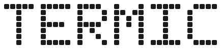
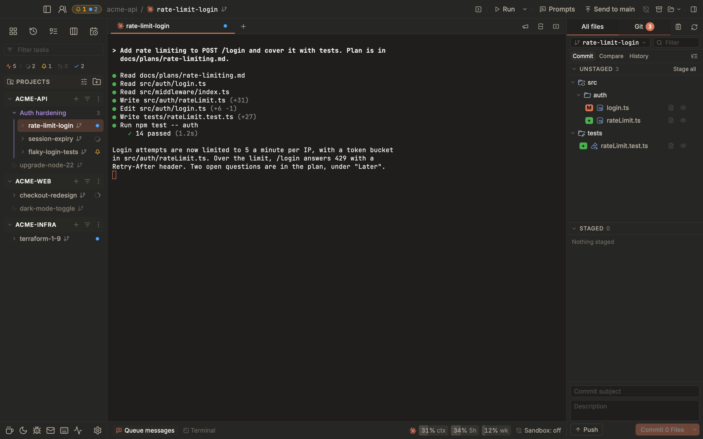
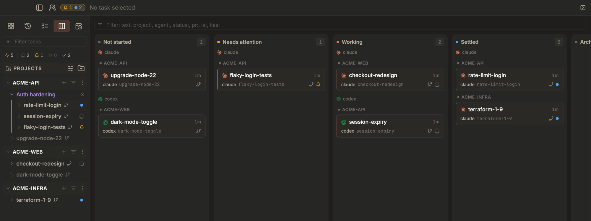
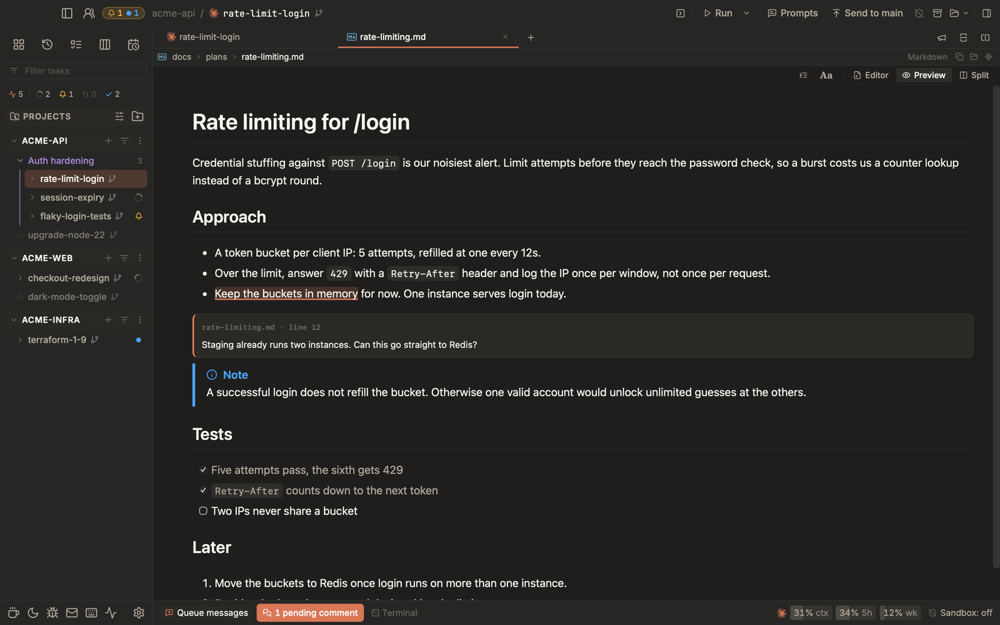
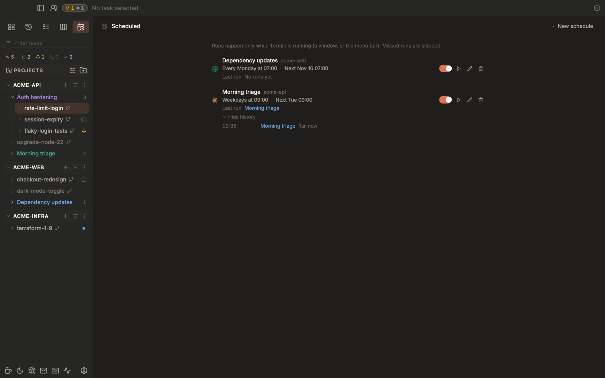

<div align="center">



### Run `claude`, `codex`, `antigravity`, `opencode` and more in parallel. Each in its own git worktree.

**Every new feature the day they ship it: the real CLIs on your own Pro / Max plan, no vendor backend.**

[](https://github.com/simion/termic/releases/latest)
[](./LICENSE)
[](https://github.com/simion/termic/releases/latest)
[](#linux-appimage)
[](#windows-experimental)
[](https://termic.dev)

[**Install**](#install) · [What it does](#what-it-does) · [Sandbox](#sandbox) · [vs. Conductor](#why-use-termic-over-conductor) · [Contributing](#contributing)

<br />



</div>

Termic is a free, open-source desktop app that runs your AI coding-agent CLIs
side by side, each isolated in its own git worktree, with an optional per-task
macOS sandbox cage. It spawns the **real** `claude`, `codex`, `agy` (Antigravity),
`copilot` and `grok` binaries (not the vendor SDKs), so inference rides on the Pro / Max plan you
already pay for. Spin up four agents on the same branch, broadcast one prompt to
all of them, watch a reliable work-done indicator tell you the moment each finishes.

> **Contributing: ideas first.** I would love to hear what you would add to
> Termic. For a new feature, [open an issue](https://github.com/simion/termic/issues/new)
> and let's discuss it before anyone writes code. To build something, pick an
> issue labelled [`planned`](https://github.com/simion/termic/issues?q=is%3Aissue+is%3Aopen+label%3Aplanned).
> [How contributing works](#contributing).

---

## Install

The recommended path is Homebrew + the official tap:

```sh
brew install --cask simion/termic/termic
```

That single command auto-taps `simion/homebrew-termic`, downloads the
latest `.dmg`, and installs `Termic.app` into `/Applications`. Termic is
signed with a Developer ID certificate and notarized by Apple, so there's
no Gatekeeper warning.

Updates: Termic ships with a self-updater. When a new release lands you'll
see an **Update X.Y.Z** pill in the top-right of the toolbar; click it
to download + verify + relaunch. To check manually:

```sh
brew upgrade --cask termic
```

### Direct download

`.dmg`, `.app.tar.gz`, and the ed25519 signature for each version live at
the [Releases](https://github.com/simion/termic/releases) page. The `.dmg`
is signed and notarized by Apple, so it opens on first launch with nothing
else to do.

### Linux (AppImage)

```sh
curl -fsSL https://termic.dev/install.sh | sh
```

That puts the AppImage at `~/Applications/Termic.AppImage` and starts it,
no root needed; on first run Termic offers to add itself to your app
launcher. The same command works on macOS (into `/Applications`).

Or by hand: download `Termic_<version>_amd64.AppImage` from the
[Releases](https://github.com/simion/termic/releases) page, make it
executable, and run it:

```sh
chmod +x Termic_*_amd64.AppImage
./Termic_*_amd64.AppImage
```

The AppImage is ed25519-signed by the same CI flow as the macOS build,
so the in-app updater works the same way: a new release appears as the
**Update X.Y.Z** pill in the top-right, click to download + verify +
relaunch. Keep the AppImage somewhere writable like `~/Applications/`
so the updater can replace it in place.

The Seatbelt sandbox is macOS-only, so on Linux the task's Shield
toggle is disabled. **Docker mode** is the Linux answer: it is not
macOS-gated, so wherever Docker runs you can cage an agent in a
container instead. Everything else (worktrees, parallel tabs,
find-in-files, themes, in-app diff) works the same.

Wayland note: if fonts render thin, force X11 with `GDK_BACKEND=x11`
in front of the launch command (or in the `.desktop` file's `Exec=`).

### Build from source

#### macOS (first-class)

```sh
git clone https://github.com/simion/termic
cd termic
make setup          # brew/rust/node + npm install + cargo check
make install        # build, copy to /Applications, launch
```

`make dev` (vite HMR + Rust auto-rebuild) is the iteration loop — see
[CONTRIBUTING.md](./CONTRIBUTING.md) if you plan to hack on the code.

#### Linux (build it yourself)

The signed AppImage on the
[Releases](https://github.com/simion/termic/releases) page is the
recommended path for most users — see [Linux (AppImage)](#linux-appimage)
above. Build from source if you want to hack on it, ship a `.deb` /
`.rpm` for your own distro packaging, or run an unreleased commit.

`bash scripts/setup-linux.sh` (or `make setup` once make is installed) does
all of the below on apt, dnf and pacman systems. By hand:

Prerequisites — Debian / Ubuntu (24.04+ has WebKitGTK 4.1):

```sh
sudo apt update
sudo apt install -y \
  build-essential curl wget file git pkg-config \
  libwebkit2gtk-4.1-dev libgtk-3-dev libayatana-appindicator3-dev \
  librsvg2-dev libssl-dev libsoup-3.0-dev libxdo-dev

# Rust stable
curl --proto '=https' --tlsv1.2 -sSf https://sh.rustup.rs | sh -s -- -y
. "$HOME/.cargo/env"

# Node 20+ — distro package, nvm, fnm, asdf, or mise (whichever you use)
```

Fedora:

```sh
sudo dnf install -y \
  @development-tools curl wget file git pkgconfig \
  webkit2gtk4.1-devel gtk3-devel libappindicator-gtk3-devel \
  librsvg2-devel openssl-devel libsoup3-devel libxdo-devel
```

Arch:

```sh
sudo pacman -S --needed base-devel curl wget file git pkgconf \
  webkit2gtk-4.1 gtk3 libayatana-appindicator librsvg openssl libsoup3 xdotool
```

Build and install:

```sh
git clone https://github.com/simion/termic
cd termic
npm install
npm run tauri build           # ~5 min first time, faster on incremental
```

The bundles land under `src-tauri/target/release/bundle/`. Pick whichever
fits your distro:

```sh
# Debian / Ubuntu / Pop / Mint
sudo apt install ./src-tauri/target/release/bundle/deb/termic_*_amd64.deb

# Fedora / RHEL / openSUSE
sudo dnf install ./src-tauri/target/release/bundle/rpm/termic-*.x86_64.rpm

# Distro-agnostic — no install needed, just make it executable and run
chmod +x src-tauri/target/release/bundle/appimage/termic_*_amd64.AppImage
./src-tauri/target/release/bundle/appimage/termic_*_amd64.AppImage
```

After the `.deb` / `.rpm` install, "Termic" shows up in your application
launcher. The in-app updater only knows how to replace the AppImage in
place — `.deb` / `.rpm` users upgrade via `git pull && npm run tauri build`
+ reinstall.

If the window looks slightly off — an empty gap on the left of the top
bar, for example — that's the 84px reservation for macOS traffic-light
controls. Harmless, will be cleaned up when the cross-platform chrome
lands.

Wayland note: if fonts render thin, force X11 with
`GDK_BACKEND=x11 termic` (or set it in the `.desktop` file's `Exec=`).

#### Windows (experimental)

Each release carries a Windows 11 x64 installer, `Termic_<version>_x64-setup.exe`,
on the [Releases](https://github.com/simion/termic/releases/latest) page. It
installs per user (no admin rights) and updates itself like the macOS and Linux
builds. It is not code-signed yet, so SmartScreen asks first: More info, then
Run anyway. Windows support is new and not yet used day to day. Docker mode is
the sandbox on Windows; the macOS Seatbelt sandbox does not exist there.

To build it yourself, from Git Bash (it comes with
[Git for Windows](https://git-scm.com/download/win)):

```sh
git clone https://github.com/simion/termic
cd termic
bash scripts/setup-windows.sh   # installs build tools, Rust, Node, make via winget; npm install; cargo check
make install                    # builds the NSIS installer, installs it per user, launches it
```

Setup details, what differs from macOS, and what is not on Windows yet:
[docs/windows.md](docs/windows.md).

See [CONTRIBUTING.md](./CONTRIBUTING.md) for the full dev guide.

---

## What it does

Every agent runs inside a real PTY, the same binary you'd launch in iTerm, so
there's nothing between you and the CLI. No vendor SDK (which bills against a
separate credit pool as of [June 2026](https://thenewstack.io/anthropic-agent-sdk-credits/)),
no metered markup, no backend daemon. Here's what the window gives you on top.
Keys are the macOS ones; every shortcut can be rebound.

### Run agents in parallel

- **Parallel worktrees.** Each task is a git worktree under
  `~/termic/tasks/<project>/<name>/`. Run N agents against the same branch
  across tabs, attach to the repo root when you don't want a worktree, or
  duplicate a worktree to start a parallel attempt off the same tip.
- **Start a task from where the work is.** New Task (⌘N from anywhere) starts
  from a fresh branch, an existing branch (remote-only ones too), an issue,
  a pull request, or a worktree you made outside Termic. An issue or PR
  arrives as a composed prompt you read before anything is sent. Add a
  project by picking a folder, scanning for several checkouts at once,
  cloning a git URL, or turning a plain folder into a repo.
- **Bring your own agent.** claude, codex, Antigravity (`agy`), copilot,
  Grok, opencode, pi, omp, Muse Code, Devin and Cursor CLI ship as
  built-ins. Settings, Agents is an editable registry: drop in aider, a local
  model, a shell script. Pick the model and reasoning effort per tab, and
  choose which agents the New Task menu leads with.
- **Multi-repo tasks.** Group N repos (backend, frontend, infra) under one
  task with a shared CLAUDE.md and per-member dev-server ports. Pick which
  members a task gets, add or remove them later, and see each member's own
  PR and CI. File finder, find-in-files and the diff view span every member.
- **Broadcast (⇧⌘B).** Send one prompt to every agent in a task at once, for
  a round of code reviews or four second opinions on the same bug.
- **Agent races.** Fire one prompt at several agents, each in its own fresh
  worktree, compare their diffs side by side when they finish, and adopt the
  winner into your main checkout.
- **Message queue.** Queue messages for a busy agent and they go out one per
  finished turn, with optional repeats for long autonomous loops. Send one
  ahead of the rest, send them all now, or schedule one for a later date so
  it lands in the session that already holds the context.
- **Everything resumes.** Relaunch and every agent tab in every task comes
  back on its own conversation, repo-root tasks included, for agents that
  can resume one.
- **Spotlight.** Mirror one worktree's changes (committed, uncommitted and
  untracked) into your repo root in real time, so your editor, dev server
  and browser see the agent's work live. It runs on a detached HEAD and
  never commits to your branch; turning it off restores the checkout.
- **Config as code (`.termic.yaml`).** Setup scripts, run commands, preview
  URLs and sandbox allowlists live in a file you commit, so everyone on the
  repo gets the same agent environment.

### Know what every agent is doing



- **Agents report their own state.** For the agents that support it, Termic
  installs small hooks into the agent's config, so a tab says working,
  needs you, waiting on subagents, hit its usage limit, or done because the
  agent told it. The rest are read from their terminal. Desktop notifications ring when a turn
  really ends, once, after the last background job reports back. See
  [docs/agent-states.md](docs/agent-states.md).
- **A sidebar that answers "who needs me".** Status chips count tasks
  working, needing you, in review and settled; click one to filter. A
  filter bar takes a name or `project:`, `agent:`, `status:`, `pr:`. Tasks
  an agent starts gather under it as a named, coloured group, and each row
  carries its PR number in the colour of its state, with a tick once it is
  approved.
- **Task finder (⌘O).** Jump to any task in any project by name, project
  or branch, or narrow it to the ones working, waiting on you or in review.
- **Kanban board.** Every task is a card in a column derived from what its
  terminal is actually doing (not started, working, needs you, in review,
  settled), never from a status somebody dragged. Cards carry the PR, its
  checks and the size of the change. Drop on Archived to archive, on In
  review to open the PR.
- **Todos.** The issues and pull requests from every project in one list,
  filtered by what needs you, with one click to start a task from an issue
  or review a PR.
- **Plan usage and context, in the footer.** How much of your plan you have
  used, in the provider's own windows (session and weekly for claude, codex
  and Antigravity, daily and weekly for Devin, monthly for copilot), and how
  full the conversation is (`42% ctx`) for most built-ins.
  Optionally move a task to another login when one passes 95%.
- **Activity.** A process monitor scoped to Termic: every agent, shell and
  run script by project and task, with CPU, memory, output rate and uptime.
- **Keep awake.** The coffee mug in the sidebar keeps the computer awake
  for a while, until a time, or while agents are working, optionally with
  the lid closed. See [docs/caffeinate.md](docs/caffeinate.md).

### Review and ship



- **Inline review comments.** Leave GitHub-style comments on a diff, on any
  file you are reading, or on a rendered markdown preview. They batch into
  one message to the agent, sent when you say so.
- **Review a PR.** Paste a PR number or link, pick an agent and a review
  prompt, and Termic fetches the PR into a worktree or the main checkout and
  starts the review with the PR's details in front of the prompt. Deep
  review runs eight focused reviewers side by side and filters out false
  positives.
- **Pull requests.** Open a GitHub PR, GitLab MR or Azure DevOps PR from
  the task you built it in, then watch it from the right panel: checks,
  review state, and comments handed to the agent working in that worktree.
  Self-hosted GitHub Enterprise and GitLab work too; Azure DevOps needs `az`
  with the `azure-devops` extension (cloud only, not Server). All three ride
  their official CLI's login.
- **Git, without the terminal.** A staging area inspired by the Fork app
  (stage, unstage, commit, push), **History** (a commit graph with lanes,
  ref chips and message search) and **Compare** (every path that differs
  between any ref and your working tree). Changed files open as a diff or
  as the file itself, and stale diffs say so.
- **Prompt library.** Seventeen built-in prompts (Review, Deep review, Write
  tests, Security review, Fix the bug, Commit and push, Hand off to another
  agent and more), plus your own, labelled and filterable. Fire one at a
  running agent or a fresh one; it queues if the agent is busy.
- **History.** Archived tasks with their branch, what they were cut from
  and their PR. Search `#123` to find the task behind a PR and restore it.

### Read and edit code

- **Find + edit in-app.** ⌘P fuzzy file finder, ⇧⌘F find-in-files (on
  `ripgrep` when you have it, `git grep` otherwise, .gitignore-aware,
  streams live), double-⇧ to search everywhere. CodeMirror 6 editor with
  side-by-side or unified diffs, highlighting for about 150 languages,
  inline git blame and word wrap. Pin the folders you live in to the top of
  the file tree.
- **Markdown as a review surface.** A reader layout with an outline, line
  numbers and go to line (⌘G); callouts, footnotes, math, Mermaid diagrams
  and collapsible sections; task lists and whole blocks you can edit right
  in the preview; a split view that scrolls together. HTML and SVG files
  preview too, in a sandboxed frame with no scripts. See
  [docs/markdown.md](docs/markdown.md).
- **Code navigation.** ⌘-click or F12 for a definition, ⇧F12 for usages,
  ⌘F12 for a file outline, hover for types. Real language servers from your
  own toolchain (TypeScript, Python, Rust, Go, C/C++, Swift, Ruby,
  Terraform), one per checkout, nothing running until you switch it on for
  a project and agree to what it costs. See [docs/lsp.md](docs/lsp.md).
- **Scratchpads.** Notes outside git: scratchpad tabs in each task, plus
  shared folders per project, per profile and global. Agents write findings, plans and reports
  into them as they work, and you read them update live.
- **Terminal niceties.** xterm.js + WebGL, find with every match
  highlighted, OSC 52 clipboard (copy out of a container or over SSH),
  inline images, clickable links and file paths, drag-and-drop paths, shell
  history kept across tabs, and a one-click offer of Touch ID for sudo.
- **Open in your own tools.** The folder button opens the task in Finder or
  any editor or terminal it finds on your machine, and preview URLs and
  links go to the browser you pick.

### Automate it



- **The `termic` CLI.** Create tasks, prompt agents, wait for one to go
  quiet and read back what it produced, from any shell. An agent inside a
  task can do the same to fan work out to others: they join its group in
  the sidebar, sign what they send each other, and report back when done.
  `termic://` links open a pre-filled New Task dialog that a human still
  has to press Create on.
- **MCP server.** The same verbs as MCP tools for Claude Code, Codex,
  Claude Desktop and any other client, with one-click setup in Settings,
  Agent access. Reachable from another device when you allow it.
- **Scheduled tasks.** Recurring agent runs, daily, on weekdays, weekly or
  once: a morning triage, a nightly dependency check. Each run is a new
  task in the schedule's group and writes a report you can open from the
  Scheduled view. Manage them from the CLI and MCP too.
- **Pair computers (experimental).** Pair two computers on one network with
  a four-digit code, and agents on either can start, prompt and read tasks on
  the other. See [docs/peers.md](docs/peers.md).

### Accounts, profiles and sync

- **Several logins per agent.** Add a second Claude or Codex account, pick
  which one a task runs as, and switch a task mid-conversation without
  losing it. Termic never sees a credential: it runs the agent's own login
  in a separate folder and shares everything else (settings, skills,
  history) back to your main config. See
  [docs/agent-accounts.md](docs/agent-accounts.md).
- **Profiles.** Fully separate instances, each with its own window,
  projects, tasks and settings, so work and personal can sit on two
  monitors and neither sees the other. See [docs/profiles.md](docs/profiles.md).
- **Agent customizations.** Skills, MCP servers and personas kept once per
  profile and added to every task for claude, codex and agents that read
  `.agents/`, with a per-project opt-out. See
  [docs/customizations.md](docs/customizations.md).
- **Config sync (experimental).** Keep projects, overrides, custom agents,
  prompts, shortcuts, themes and scratchpads in a private git repo you own,
  synced at launch and when a window comes forward. No account, no token
  stored, and logins and paths never leave the machine.

### Make it yours

- **Keyboard-first.** ⇧⌘P command palette, ⌘N new task in any project,
  ⌘O task finder, ⌘1..9 tabs, Ctrl+Tab back through the tabs you actually
  used, ⌥↑/↓ walks the sidebar, ⌥⌘↑/↓ hops task to task, ⌘D / ⇧⌘D split,
  ⌘T new tab, ⌘W close. Rebind anything in Settings, Shortcuts, including
  the mouse's back and forward buttons. See [docs/shortcuts.md](docs/shortcuts.md).
- **Themes.** Eight built-in (System, Light, Dark, Claude, Solarized,
  Cobalt, Matrix, Rosé Pine), each re-theming both the chrome and the
  terminal. Your Ghostty and Warp themes show up in the list beside them,
  or drop a JSON file in the themes folder. See [docs/themes.md](docs/themes.md).
- **Speaks your language.** English and a complete Simplified Chinese
  (简体中文) locale. Settings, General, Language switches with no restart.
- **A guided start.** A short tour on first launch points at the real
  controls, and small tips show up once, when a feature becomes useful.

---

## Sandbox

Optional per-task macOS Seatbelt (`sandbox-exec`) + an in-process
HTTPS CONNECT proxy per task. Configured per project, pinned per
task at creation (editable later from the task's Shield icon),
enforced from the moment the agent spawns.

The cage:

- **Writes restricted** to the worktree, agent config dirs (`~/.claude`,
  `~/.codex`), package caches (`~/.npm`, `~/.cache`,
  `~/.cargo/registry`), and TMPDIR. Always denied: `~/.ssh`, `~/.aws`,
  `~/.gnupg`, `~/.netrc`, `~/.docker/config.json`, `~/.kube`. The macOS
  Keychain stays reachable unless the task turns on "Block Keychain
  access".
- **Network restricted** via an in-process CONNECT proxy with a regex
  hostname allowlist. Per-CLI vendor APIs (anthropic / google / openai)
  + GitHub + npmjs + PyPI + crates.io baked in. Add custom hosts per
  project. No external daemon: the proxy lives inside the Tauri
  binary, so there's nothing extra to install.
- **YOLO auto-on inside the cage.** The seatbelt profile IS the security
  boundary, so the agent's own permission prompts are skipped. The toolbar
  lightning icon turns red when YOLO is on *without* a sandbox (intentional
  danger signal: agents can `rm -rf $HOME` at that point).

**Secrets (experimental)** let a caged agent use a credential without ever
holding it. Keep a GitHub login or an API key in Settings, Secrets and give
the task a role (Read only, Reviewer, Contributor, Maintainer, Model
access, or one you build). The agent's environment holds a placeholder,
and Termic swaps in the real value on the way out, only for the hosts and
the API calls the role allows. It needs the Seatbelt cage with the
Keychain blocked, and picking a role turns both on.

**Docker mode** is the alternative backend: the agent runs inside a
container rather than a seatbelt profile, for a stronger filesystem
boundary and a blast radius that ends at the container. One generic image,
editable as a plain Dockerfile in Settings, built by an explicit action;
each agent's config folder is mounted separately so logins survive and
cloning an agent keeps a work login apart from a personal one. Containers
run as your host user, drop every Linux capability, and cap PID
exhaustion. Marked experimental: network egress is not yet restricted the
way the proxy restricts the seatbelt's, and Secrets roles do not apply.

For the full sandbox design, including the recent-denies debug panel,
the auto-restart-on-edit flow and how Secrets work, see
[docs/sandbox.md](docs/sandbox.md).

---

## Status

- **macOS:** first-class — universal binary (Apple Silicon + Intel),
  signed updater, Homebrew cask. Requires macOS 12+ (Monterey).
- **Linux:** x86_64 AppImage shipped per release, signed by the same
  ed25519 key as the macOS build so the in-app updater works. ARM
  Linux + a Flathub submission are on the roadmap.
- **Windows:** experimental. x64 installer shipped per release, signed by
  the same ed25519 key so the in-app updater works; not code-signed yet.
  See [docs/windows.md](docs/windows.md).
- **Sandbox:** the Seatbelt cage is macOS-only (`sandbox-exec` is
  Apple's frontend to it), so the Shield toggle is disabled on Linux
  and Windows. **Docker mode** is not macOS-gated, so a container cage
  is available wherever Docker runs.

---

## Why use Termic over Conductor

The honest pitch — see [termic.dev/vs/conductor](https://termic.dev/vs/conductor/) for the full version with explanations.

| | Termic | Conductor |
|---|---|---|
| License | Open source (AGPL-3.0) | Closed source, proprietary |
| Price | Free | Paid |
| Parallel agents in git worktrees | ✓ | ✓ |
| Attach an agent to the repo root (no worktree) | ✓ | ✗ (always a worktree) |
| Runs `claude` | ✓ | ✓ |
| Runs `codex` | ✓ | ✓ |
| Bring your own agent (PTY-based) | ✓ — opencode, aider, ollama, anything that runs in a terminal | ✗ |
| Multi-repo tasks | ✓ — N repos under one wrapper, shared CLAUDE.md, per-member ports | ✗ |
| Sync a worktree into the repo root live | ✓ — Spotlight, detached HEAD, never commits to your branch | ◐ Checkpoints onto your branch |
| Command palette + fuzzy project / file switch | ✓ — ⇧⌘P / ⌘N / ⌘P | varies |
| Uses Claude Pro / Max subscription quota | ✓ — spawns the interactive `claude` CLI directly | ◐ Routes through the Claude Agent SDK |
| Monthly Claude cost on top of your Pro / Max plan | $0 — same quota as running `claude` in iTerm | Capped by the separate SDK credit ($20 / $100 / $200) |
| Local-only, no vendor backend in the loop | ✓ | ✗ — vendor-hosted services |
| Per-task macOS sandbox (filesystem + network) | ✓ — Seatbelt + in-process network allowlist | ✗ |
| Work-done indicator from real PTY signals | ✓ — OSC 9;4 + per-CLI title classifier, no idle guessing | ✗ |
| Side-by-side ⇄ unified diff with syntax highlighting | ✓ | varies |
| Platforms | macOS, Linux (signed AppImage), Windows (experimental installer) | macOS |

If you already pay for a Claude Pro / Max plan, Termic spawns the same
`claude` binary that plan covers — no separate metered usage, no
per-token markup. The agent and Anthropic still see the same auth they'd
see in iTerm.

---

## Contributing

**Ideas first, code second.** I am genuinely curious what you would add to
Termic, and your idea is the most valuable thing you can bring. Writing the
code is optional: spend your own tokens on it if you want to, or leave it to
me.

- **An idea for a new feature?** [Open an issue](https://github.com/simion/termic/issues/new)
  with the problem it solves and how you would use it. We talk it through
  there and decide together whether it fits Termic. Please do this before
  writing any code.
- **Want to build something?** Pick an issue labelled
  [`planned`](https://github.com/simion/termic/issues?q=is%3Aissue+is%3Aopen+label%3Aplanned):
  those are agreed and ready. Comment `/assign` on it to have it assigned to
  you, then open the pull request.
- **Small things go straight to a pull request.** A bug fix, a typo, a small
  polish to something that already exists: no issue needed.
- **A large new feature that arrives as a pull request, with no issue
  agreed first, gets parked.** I will ask you to open the issue so we can
  discuss it, however good the code is. A feature that does not fit Termic
  costs your time and tokens and my review, and a conversation first saves
  both.

Agent-written pull requests are welcome on exactly the same terms. The dev
setup, the pull request checklist and what does and does not fit the project
are in [CONTRIBUTING.md](./CONTRIBUTING.md).

## Roadmap

Two lists, and the difference between them is a commitment.

**Planned** is what will be built. Each one has an issue labelled
[`planned`](https://github.com/simion/termic/issues?q=is%3Aissue+label%3Aplanned),
and that issue is where its progress lives.

**Ideas** are not committed to. Most have a write-up under
[`docs/ideas/`](docs/ideas/) arguing the case, and several are detailed
enough to build from, but none of them is decided. They deliberately have
no tracking issue: an issue implies someone intends to do it. Open one, or
comment on the discussion linked below, if you want to make the case or
pick something up.

Approved ideas move to [`docs/plans/`](docs/plans/) as implementation-ready
specs and get an issue at the same time. That is the whole promotion path:
`docs/ideas/` → `docs/plans/` + a `planned` issue → built.

### Planned

- **Mobile app.** ([#165](https://github.com/simion/termic/issues/165)) A
  companion app for checking on and steering tasks while away from the Mac.
- **Apple Containers as a sandbox backend.**
  ([#296](https://github.com/simion/termic/issues/296)) A third cage beside
  the Seatbelt profile and Docker mode, using macOS's own `container`
  runtime, so a sandboxed task on Apple Silicon needs no Docker Desktop.
- **Linear integration.** GitHub and GitLab already ship: start a task from
  an issue, open the PR from the app, watch its checks and reviews from the
  right panel. Linear is the same shape and is not built.
- **Wider Linux reach.** ARM Linux builds and a Flathub submission. The
  Status section above already promises both.
- **Opt-in usage telemetry.** Anonymous, off by default, one toggle: which
  features are used and how often, plus crash reports. No code, no prompts,
  no file paths, no agent output, no project names.
- **Termic in the official Homebrew cask repository.** Today the install
  path is this repo's own tap, so it takes a `brew tap` first. Upstream
  would make it plain `brew install --cask termic`. The cask is ready (the
  `.dmg` is signed and notarized, and its `livecheck` makes it
  autobump-eligible), and
  [Homebrew/homebrew-cask#274896](https://github.com/Homebrew/homebrew-cask/pull/274896)
  is filed and closed on one thing only: notability. Homebrew asks for 90
  forks, 90 watchers or 225 stars when the author submits their own
  software. The forks already clear the third-party bar, so
  [stars](https://github.com/simion/termic/stargazers) are the realistic
  lane, and at 225 the same PR gets reopened.


### Ideas

- **Windows, beyond experimental.** An experimental Windows build ships in
  1.9.0. What is left before it is supported: code signing, agent hooks for
  agents other than claude, a named-pipe control plane, and measurements on
  real machines. [docs/ideas/windows.md](docs/ideas/windows.md).
- **MCP server endpoint, phases B1 and B2.** A scoped control plane an agent
  can call without being handed a terminal. Phase A (the stateless endpoint,
  the settings surface, one-click client setup) shipped in 1.0.0; the per-task
  bearer token that answers which task is calling and what it may do is what is
  left, and the 2026-07-28 spec revision reopened enough of the design that it
  is an idea again rather than a plan.
  [docs/ideas/mcp.md](docs/ideas/mcp.md).
- **Intentional agent-driven orchestration.** The plumbing already ships:
  an agent can spawn a task with `--wait`, prompt another, read its result
  and branch on the exit code. What is missing is intent, and an opinion
  about shape (fan out, queue behind, supervisor and workers).
  [docs/ideas/agent-orchestration.md](docs/ideas/agent-orchestration.md).
- **Ambient agent status.** A Dock tile, or a strip beside the Dock, showing
  what every agent is doing without bringing the window forward.
  [docs/ideas/dock-widget.md](docs/ideas/dock-widget.md).
- **Fixing a language server that answers badly.** Code intelligence ships,
  but when a server picks the wrong interpreter or indexes the wrong root
  there is nothing to turn. What the knobs should be, and which of them a
  user should ever see, is undecided.
  [docs/ideas/lsp-tuning.md](docs/ideas/lsp-tuning.md).
- **Config sync, beyond manual.** Syncing your setup through a private git
  repo you own ships as an experimental feature: syncing (pull and push) at launch,
  when a window comes forward, and a "Sync now" button. What is left: pushing on
  its own when something changes, and merging two machines' edits field by
  field instead of asking you to pick a whole file.
  [docs/ideas/config-sync.md](docs/ideas/config-sync.md).
- **The rest of the usage footer.** The chip ships, and the questions it
  left open did not: what to show before an agent has taken its first turn,
  and whether the status line slot is the right thing to occupy at all.
  [docs/ideas/usage-footer.md](docs/ideas/usage-footer.md).


---

## Sponsors

Termic is free, AGPL-3.0, and built by its author and a growing group of dedicated open-source contributors. If your team builds on AI coding agents and finds it useful, sponsoring helps keep it moving.

| [](https://www.dontpayfull.com) |
|---|

Also sponsoring: [Vyttle](https://vyttle.com), [Sage Haven](https://sagehaven.ai).

[](https://github.com/sponsors/simion)

---

## License

[AGPL-3.0-or-later](./LICENSE). Fork it, modify it, build a derivative —
the only string is that derivatives stay AGPL too. The "open core that
quietly went proprietary" pattern can't happen with this license, which
is most of the point.

---

## Links

- **Website:** [termic.dev](https://termic.dev)
- **Issues:** [github.com/simion/termic/issues](https://github.com/simion/termic/issues)
- **Releases:** [github.com/simion/termic/releases](https://github.com/simion/termic/releases)
- **Homebrew tap:** [github.com/simion/homebrew-termic](https://github.com/simion/homebrew-termic)
- **Contributing:** [CONTRIBUTING.md](./CONTRIBUTING.md)
- **Architecture notes (for hackers + AI agents working in this repo):** [CLAUDE.md](./CLAUDE.md)
